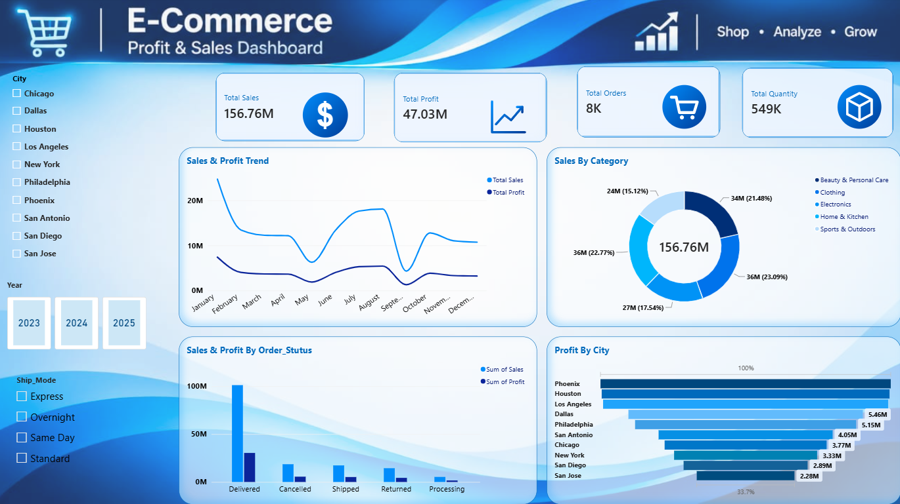
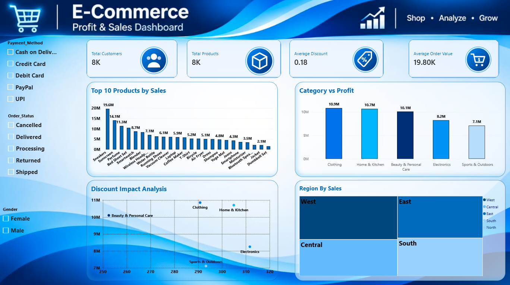
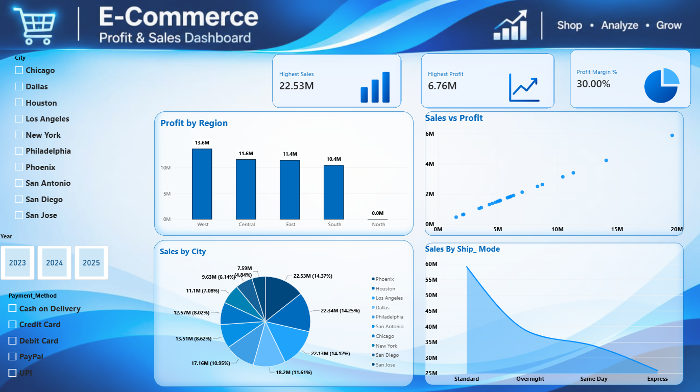

# E-Commerce-Profit-and-sales_Project.pbix
This Power BI project focuses on analyzing E-Commerce sales and profit performance using interactive dashboards. It includes data cleaning, transformation, DAX calculations, KPI analysis, sales trends, product performance, customer insights, and regional analysis. The dashboard helps identify business growth opportunities and supports data-driven decision-making through effective data visualization.

